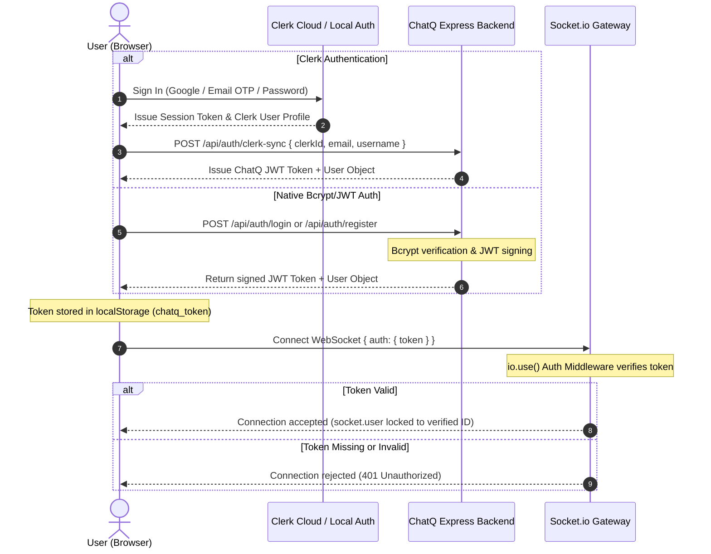
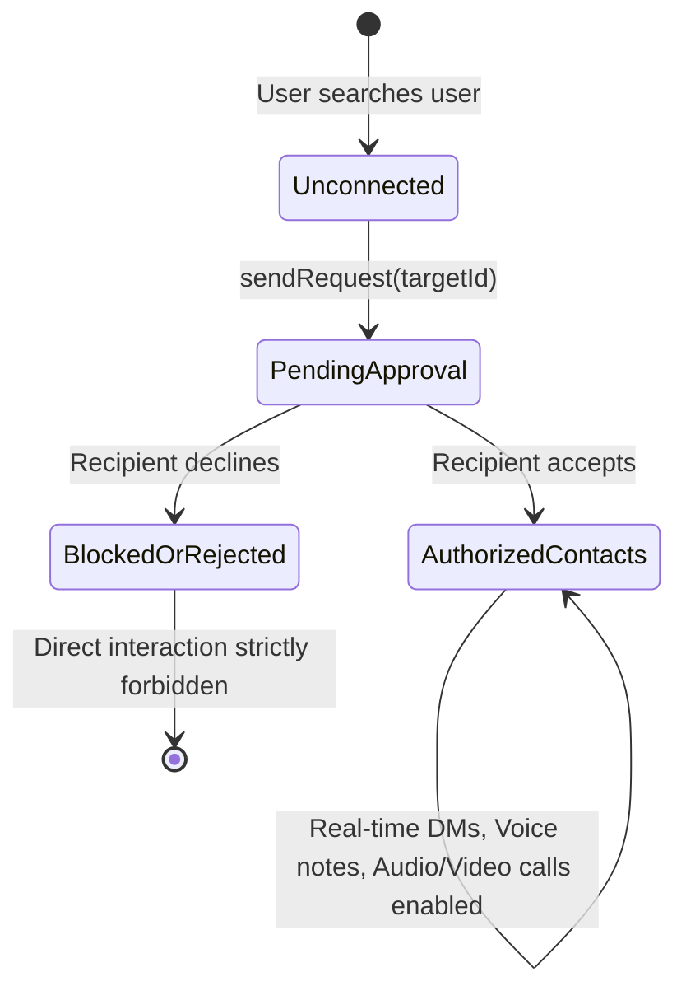
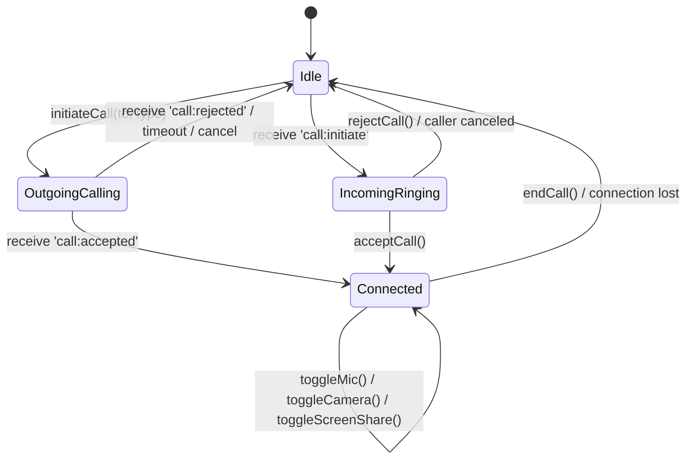
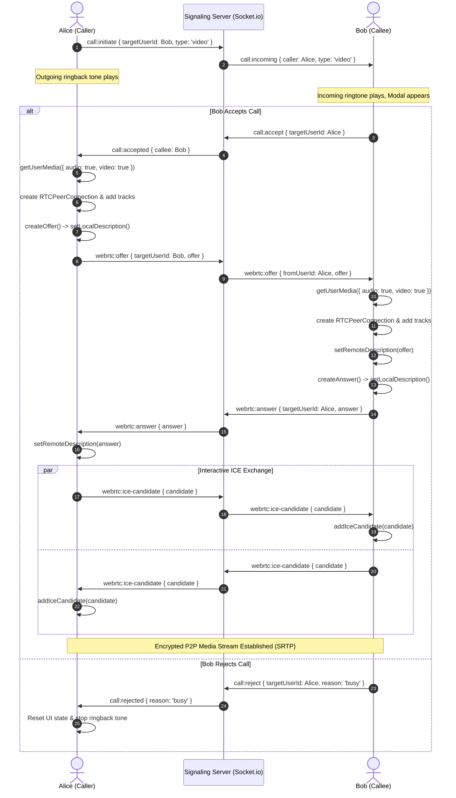

# ChatQ: Real-Time Chatting, Media Sharing, Audio & Video Calling Platform
## System Architecture & Technical Design Specification

---

## 1. Executive Overview

**ChatQ** is an enterprise-grade real-time communication platform built for secure text messaging, rich multimedia sharing, and low-latency peer-to-peer (P2P) WebRTC audio and video calling.

### Core Capabilities
- **Robust Authentication & Identity**: Hybrid authentication supporting native **Bcrypt + JWT sessions** and seamless plug-and-play **Clerk Authentication** (Google/OAuth, Passkeys, Magic links, MFA).
- **Socket-Level Authorization**: Every WebSocket handshake is validated against signed JWTs or Clerk session tokens, completely blocking unauthorized eavesdropping or message injection.
- **Instant Messaging**: Real-time 1-on-1 and group communication with typing indicators, presence, and read receipts.
- **Rich Media Sharing**: File sharing (photos, videos, documents, audio clips) with on-the-fly previews, lightboxes, and download support.
- **Audio Voice Notes**: In-browser audio recording via `MediaRecorder` API with immediate waveform preview and streaming transmission.
- **Audio & Video Calling**: Ultra-low-latency peer-to-peer (P2P) WebRTC communication with bidirectional audio/video streams, screen sharing, call negotiation, dynamic mute/camera controls, and call state management.

---

## 2. Security & Authentication Architecture

### 2.1 Multi-Tier Authentication Strategy
ChatQ supports a dual-engine authentication architecture:
1. **Built-in Secure Local Auth**:
   - Passwords hashed using **Bcrypt** with salt rounds = 10.
   - Session tokens generated as signed **JSON Web Tokens (JWT)** with 7-day expiration.
   - Persistent disk-backed user database (`data/users.json`).
   - 1-Click Demo Profiles (Alice, Bob, Charlie) for instant local testing across tabs.
2. **Clerk Integration**:
   - Integrates with Clerk's official JavaScript SDK (`@clerk/clerk-js`) on the frontend and `@clerk/backend` on Express.
   - Allows users to sign in via Google, GitHub, Apple, Email OTP, or passkeys.
   - Clerk session tokens are synced to the backend via `/api/auth/clerk-sync` and verified directly.



### 2.2 Defense-in-Depth Security Measures

| Security Layer | Implementation | Defense Against |
|---|---|---|
| **Mutual Contact Authorization** | Server validates `contactManager.areContacts()` on every message and call | Unsolicited messages, spam, harassment, and unauthorized calling |
| **Identity Locking** | Sockets tag all messages with verified `socket.user.id` | User impersonation and payload spoofing |
| **Brute Force Protection** | `express-rate-limit` (100 req / 15 min on `/api/auth/*`) | Credential stuffing and password cracking |
| **Upload Guard** | Strict MIME whitelist, file size cap (50MB), filename sanitization | Arbitrary code execution and path traversal |
| **Protected Uploads** | `/api/upload` enforces `requireAuth` JWT validation | Anonymous storage exhaustion attacks |
| **HTTP Security Headers** | `helmet` CSP, HSTS, X-Content-Type-Options | XSS, clickjacking, MIME sniffing |
| **WebRTC Media Security** | DTLS-SRTP mandatory encryption for all RTP streams | Man-in-the-middle eavesdropping on audio/video |

---

## 3. Contact Request & Authorization Lifecycle

ChatQ enforces a strict mutual consent model for direct user-to-user interactions:
1. **Request Stage**: User A searches User B by username or email and sends a contact request (`POST /api/contacts/request`).
2. **Pending Stage**: The relationship status enters `pending`. The server prevents any direct messages, media sharing, or audio/video calls between User A and User B.
3. **Acceptance**: When User B accepts the request (`POST /api/contacts/respond` with `action: 'accept'`), both users' contacts lists are updated in real-time.
4. **Rejection**: If User B declines, the request enters `rejected`. No interaction is permitted.
5. **Real-Time Notification**: Socket.io emits `contact:request:received` and `contact:request:resolved` with instant badge updates and sound chimes.



---

## 3. High-Level Architecture (HLD)

```mermaid
graph TD
    subgraph Clients
        ClientA["Client A (Browser)"]
        ClientB["Client B (Browser)"]
    end

    subgraph "Application & Signaling Tier (Node.js / Express)"
        HttpServer["Express HTTP Server<br/>(Rate limited, Helmet CSP)"]
        AuthModule["Auth & Identity Engine<br/>(Bcrypt, JWT, Clerk SDK)"]
        SocketServer["Socket.io Authenticated Signaling Server<br/>(io.use Token Auth)"]
        UploadHandler["Protected Multer Ingest<br/>(MIME whitelist, Path sanitization)"]
    end

    subgraph "Storage & Network Tier"
        DiskStorage["Secure Disk Storage<br/>(/uploads & /data)"]
        STUN["Public STUN Servers<br/>(NAT Discovery / IP Reflexive)"]
        TURN["TURN Relay Server<br/>(Fallback for Symmetric NATs)"]
    end

    %% Client Interactions
    ClientA -->|1. Authenticate (Clerk / Local)| AuthModule
    ClientA -->|2. Authenticated Socket Handshake| SocketServer
    ClientA -->|3. POST /api/upload (Bearer Token)| UploadHandler
    UploadHandler -->|Persist Media| DiskStorage

    ClientB -->|1. Authenticate (Clerk / Local)| AuthModule
    ClientB -->|2. Authenticated Socket Handshake| SocketServer
    ClientB -->|3. POST /api/upload (Bearer Token)| UploadHandler

    %% WebRTC Signaling & Media Flow
    SocketServer <-->|Signaling: SDP Offer/Answer, ICE| ClientA
    SocketServer <-->|Signaling: SDP Offer/Answer, ICE| ClientB

    ClientA -.->|NAT Discovery| STUN
    ClientB -.->|NAT Discovery| STUN

    ClientA <==>|Encrypted P2P Media Stream (SRTP/SRTCP)| ClientB
    ClientA -.->|Fallback Media Relay| TURN
    TURN -.->|Fallback Media Relay| ClientB
```

---

## 4. WebRTC Signaling & Calling Architecture

WebRTC media tracks are exchanged directly peer-to-peer. Socket.io serves as this signaling channel, restricted exclusively to authenticated users.

### 4.1 Call State Machine



### 4.2 Signaling Sequence Diagram (P2P Audio/Video Call)



---

## 5. Clerk Integration Guide

To connect your own Clerk instance to ChatQ:

1. Create a project at [Clerk Dashboard](https://dashboard.clerk.com).
2. Copy your **Publishable Key** and **Secret Key**.
3. Add to your `.env` file in the project root:
   ```env
   CLERK_PUBLISHABLE_KEY=pk_test_YOUR_KEY_HERE
   CLERK_SECRET_KEY=sk_test_YOUR_KEY_HERE
   ```
4. Restart the server (`npm start`).
5. ChatQ automatically detects Clerk credentials, dynamically loads `@clerk/clerk-js`, and allows your users to authenticate via Google, GitHub, or email magic links!

---

## 6. Supabase Chat History Integration Guide

ChatQ uses **Supabase** for persistent, scalable message history across sessions, devices, and server restarts.

### 6.1 Database Setup (1-Click SQL)
1. Sign up or log in at [Supabase Dashboard](https://supabase.com/dashboard).
2. Create a new project.
3. Open the **SQL Editor** from the left navigation.
4. Open the provided [`supabase_schema.sql`](file:///media/bugopsx/A/WORKSHOP/chatQ/supabase_schema.sql) file in this repository and run the script:
   ```sql
   CREATE TABLE IF NOT EXISTS public.messages (
       id TEXT PRIMARY KEY,
       room_id TEXT NOT NULL,
       sender_id TEXT NOT NULL,
       sender_name TEXT NOT NULL,
       sender_avatar TEXT,
       target_user_id TEXT,
       content TEXT DEFAULT '',
       type TEXT DEFAULT 'text',
       attachment JSONB,
       created_at BIGINT NOT NULL DEFAULT (EXTRACT(EPOCH FROM NOW()) * 1000)::BIGINT
   );

   CREATE INDEX IF NOT EXISTS idx_messages_room_created ON public.messages(room_id, created_at ASC);
   CREATE INDEX IF NOT EXISTS idx_messages_sender ON public.messages(sender_id);
   CREATE INDEX IF NOT EXISTS idx_messages_target ON public.messages(target_user_id);

   ALTER TABLE public.messages ENABLE ROW LEVEL SECURITY;
   CREATE POLICY "Allow public read access" ON public.messages FOR SELECT USING (true);
   CREATE POLICY "Allow public insert access" ON public.messages FOR INSERT WITH CHECK (true);
   ```

### 6.2 Configure Credentials
In your [`.env`](file:///media/bugopsx/A/WORKSHOP/chatQ/.env) file:
```env
SUPABASE_URL=https://your-project.supabase.co
SUPABASE_KEY=your-anon-or-service-key
```

### 6.3 Resilience & Fallback
- If Supabase credentials are not set or during network outages, ChatQ seamlessly persists chat history to local disk backup (`data/messages.json`), guaranteeing zero downtime or lost messages.

---

## 7. Cloudinary Cloud Media Backup Integration Guide

ChatQ integrates with **Cloudinary** to offload file uploads, audio voice notes, videos, and photos to a high-speed CDN with global delivery.

### 7.1 Configuration
1. Create a free account at [Cloudinary Console](https://console.cloudinary.com).
2. Copy your **Cloud Name**, **API Key**, and **API Secret** from your Dashboard.
3. Add them to your [`.env`](file:///media/bugopsx/A/WORKSHOP/chatQ/.env) file:
   ```env
   CLOUDINARY_CLOUD_NAME=your_cloud_name
   CLOUDINARY_API_KEY=your_api_key
   CLOUDINARY_API_SECRET=your_api_secret
   ```

### 7.2 Media Workflow
- When users upload images, voice notes, or documents via `/api/upload`:
  1. The server receives the file via `multer`.
  2. The server streams the asset to Cloudinary under the `chatq_media` folder with auto-format and optimization.
  3. The returned Cloudinary `secure_url` is embedded directly into the chat message for blazing-fast CDN distribution.
  4. If Cloudinary is not configured, files are stored locally in `uploads/` with instant access.

